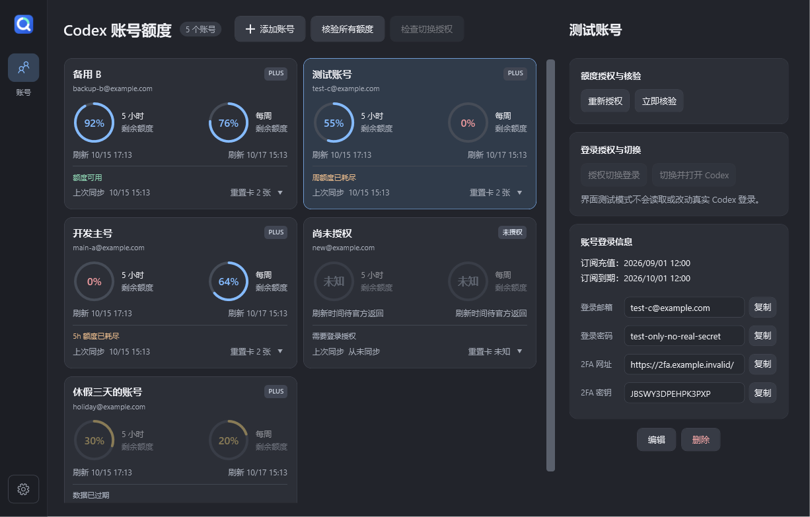

# QuotaOrb · 额度管理

Windows 桌面 Codex 多账号额度助手。**2.0.0 · MIT 开源 · Windows 10/11 x64**。

当前开发分支为 **2.1.0-preview.3**，增加独立授权及桌面账号切换测试功能。稳定发布仍为 2.0.0；两个真实账号的桌面往返切换尚待人工验收，参见 [测试版使用与验收](docs/account-switch-preview.md)。

查看账号的 5 小时和每周剩余额度、官方刷新时间与重置卡数量，在使用前判断哪些账号仍有额度。

这是独立社区工具，不是 OpenAI 官方产品。需要先安装 Codex；工具使用本机已安装的 Codex 后台组件，无需打开 Codex 桌面窗口，不附带 Codex 运行文件。



## 下载与使用

从 [Releases](https://github.com/yuchuangyong0312/QuotaOrb/releases) 下载 `QuotaOrb.exe`，放到自己的软件目录后双击运行。无需额外安装 .NET、Node.js 或 Python。

1. 先安装 Codex，并确认网络可以访问官方服务。
2. 点击 **添加账号**，填写名称与登录邮箱。密码、2FA 信息、订阅充值和到期时间均为可选的本地记录。
3. 选中账号，点击 **登录授权**，在官方网页完成登录。填写密码到本工具不等于完成授权。
4. 等待额度更新，需要时点击 **立即核验** 或 **全部核验**。

授权窗口可以最小化，同时可回主窗口复制登录信息。等待时点击右上角 × 也只最小化，点击 **取消授权** 或退出整个工具才停止。遇到本机回调失败，可用 **设备码授权**；该方式可能需要先在 ChatGPT 安全设置允许设备码登录。

关闭主窗口收回后台。双击托盘图标或桌面快捷方式可再次打开；托盘菜单的 **退出额度管理** 才会完全退出。`Ctrl+Alt+Q` 可展开或收起窗口。

## 功能

- 多账号卡片：5h / 每周剩余百分比、刷新时刻、上次同步和额度状态。
- 官方返回的重置卡数量，只读展示，不自动消费。
- 展开窗口每 **15 分钟**核验，后台或最小化每 **30 分钟**核验；支持手动核验和失败退避。
- 休眠、断网、过期快照与授权失效分别处理，不凭时间流逝把余额改成 100%。
- 账号名称、订阅日期时间、邮箱、密码、2FA 网址和密钥的管理与复制。
- 完整导入/导出资料及历史；托盘、自启、可选通知和深色响应式布局。
- 升级保留已有桌面自定义图标，托盘跟随该图标。

**2.0.0 不包含桌面账号一键切换，不会自动输入密码或替换 Codex 当前登录状态。**

## 数据与隐私

本地数据默认位于 `%LOCALAPPDATA%\QuotaOrb`。各账号额度查询授权使用独立状态目录，不读写 Codex 默认登录目录。查询使用 Codex App Server 的账号与额度接口，不发起模型任务。开发测试版中，用户主动保存或切换桌面登录时会读取默认目录的 `auth.json`；切换必须先退出 Codex，且仅替换该登录文件。

密码、2FA 信息和旧备注使用 Windows 当前用户 DPAPI 加密。**SQLite 数据库整体没有加密**：账号名称、邮箱、订阅日期、额度及历史等元数据以普通数据存储。界面按设计明文显示登录信息，请避免公开真实账号截图。

**导出的 JSON 包含明文密码、2FA 信息和备注。** 请勿提交到 GitHub 或发给他人。官方 OAuth 授权不包含在导出中；重装后可导入资料，但需重新完成官方授权。复制敏感信息后，工具尝试在 30 秒后清除仍属于它的剪贴板内容，不保证清除第三方剪贴板历史。

软件备份只需保留 `QuotaOrb.exe`，其中不包含账号数据。重装后先安装 Codex，再运行工具。

## 显示边界

- 余额和刷新时间以官方结果为准，服务端可以改变刷新时刻。工具不使用本机时间加 5 小时编造刷新时间。
- 缺失字段显示未知，历史快照过期后等待重新核验，不假定额度已恢复。
- 百分比不代表固定消息数，不同套餐的同一百分比不一定表示相同可用量。
- 订阅充值/到期是手动记录，不推算固定 30 天，也不用于证明订阅有效。
- 依赖本机 Codex 接口，官方协议变化可能需要更新工具。真实账号授权、长期续期及额度一致性仍需结合实际账号验证。

## 从源码构建

需要 Windows x64 和 `global.json` 指定的 .NET SDK 10.0.401，在仓库目录运行 PowerShell：

```powershell
dotnet run --project src/QuotaOrb.Tests -c Release
dotnet run --project src/QuotaOrb.ServiceTests -c Release
dotnet run --project src/QuotaOrb.DesktopSwitchTests -c Release
dotnet publish src/QuotaOrb/QuotaOrb.csproj -c Release -r win-x64 --self-contained true -p:RestoreLockedMode=true -p:IncludeSourceRevisionInInformationalVersion=false -o dist/QuotaOrb-2.1.0-preview.3
```

也可运行 `scripts/bootstrap.ps1` 下载并校验官方 SDK 到项目 `.tools`，再运行 `scripts/publish.ps1` 生成包含安装脚本、许可证和校验文件的内部发布目录。

原生界面检查需安装 Codex，指定**全新独立**的测试目录：

```powershell
.\dist\QuotaOrb-2.1.0-preview.3\QuotaOrb.exe --smoke-test --skip-auth-handoff --data-root C:\Temp\QuotaOrb-Smoke-New
```

测试仅使用虚构账号，并生成界面截图。`--skip-auth-handoff` 避免占用真实授权回调端口；省略它会在隔离目录启动并取消一个未登录的官方授权会话，不自动打开浏览器。不要指向实际账号目录。

默认图标为自绘图形，矢量源文件位于 `src/QuotaOrb/Assets/QuotaOrb.svg`，运行 `scripts/generate-icon.ps1` 可重建 ICO。程序内嵌自身及依赖许可证，可从设置中的第三方许可查看。

`scripts/package-release.ps1 -OutputDirectory 'D:\MySoftwareBackup\QuotaOrb'` 同步仅含 EXE 的软件备份；默认目录为维护者本机配置，可用参数覆盖。

## 反馈与许可证

在 [Issues](https://github.com/yuchuangyong0312/QuotaOrb/issues) 提供系统、Codex 和工具版本及复现步骤。**不要上传账号数据库、登录凭据、真实密码或 2FA 密钥。**

源码和自绘图标采用 [MIT License](LICENSE)。第三方组件遵循各自许可证，参见 [THIRD-PARTY-NOTICES.md](THIRD-PARTY-NOTICES.md)。
